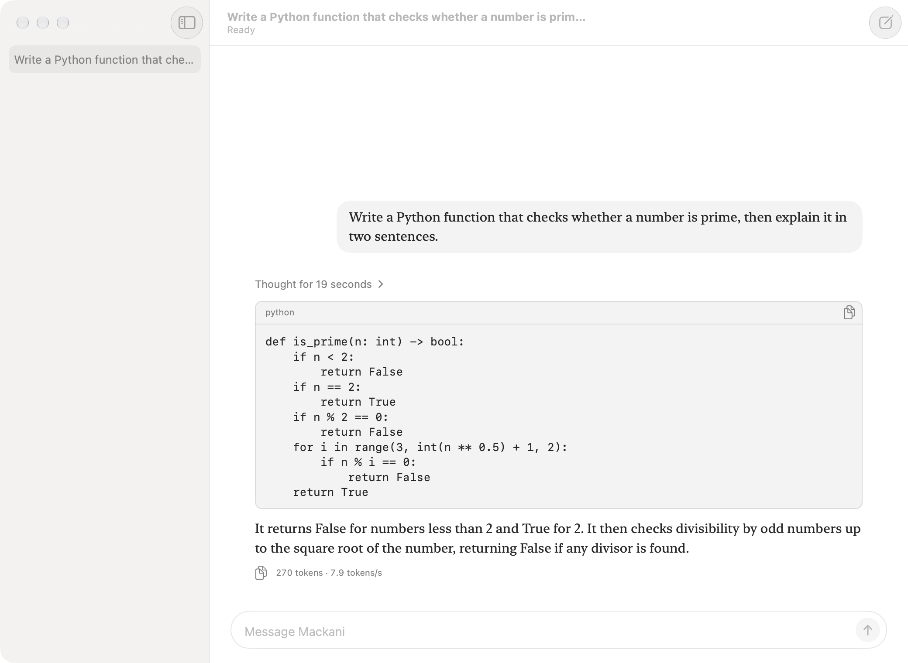

# Mackani

[YASAKANI](https://github.com/yasakani-dev/yasakani) を Apple Silicon 向けに Rust で一から実装した、非公式の移植版です。バージョンは 0.1.0 です。

[English](README.md)

YASAKANI は Windows と NVIDIA RTX 5090 1枚を対象とする、Apache-2.0 のローカルLLMエンジンです。圧縮された `.yskn` ファイルから Qwen3.8-27B を動かします。Mackani は同じ公開モデルフォルダーを Mac で読み込みます。圧縮された射影の計算には Metal、それ以外の処理には NEON とスレッドプールを使います。Rust のエンジンは上流のコードをコピーせず、コミット `758ef28` の動作をまとめた [仕様書](docs/spec/) に基づいて実装しました。

モデルファイルと `.yskn` 形式は YASAKANI 作者の成果です。モデルとエンジンを公開してくださった YASAKANI 作者に感謝します。Mackani は YASAKANI 作者、Qwen チーム、その他の組織とは関係がなく、承認や推奨も受けていません。

**動作確認したのは、ベースモデルの Apple M5 を搭載した MacBook 1台だけです。CPU は高性能4コア＋高効率6コア、GPU は10コア、メモリは24 GB、OS は macOS 27 です。モデルは speed 版だけを確認しました。** 他の Apple Silicon Mac も、実行時の機能検出とフォールバックにより動く想定ですが、未検証です。チューニング用の表も M5 だけで調整しています。他のエンジンとの比較はしていません。

## 必要なもの

- Apple Silicon 搭載の Mac と macOS 26 以降。
- [rust-toolchain.toml](rust-toolchain.toml) が指定する Rust stable、rustfmt、Clippy。
- Metal シェーダーとアプリのビルドに使う Xcode コマンドラインツール。アプリには Swift 6.2 が必要です。
- 別途ダウンロードする公開モデルフォルダー。

既定ではコンテキスト長を32,768トークンに設定し、下書きモデルを有効にします。この構成の推定必要メモリは19.03 GiBです。物理メモリに収まらない構成では起動を拒否し、収まる設定を表示します。`info` で、モデルをロードせずに見積もりを確認できます。

同じ見積もりでは、16 GB の Mac は `--draft none --ctx 16384` で動かせます。ただし、16 GB の実機では確認していません。この値はピークメモリの実測値ではありません。

## モデルを入手する

検証済みなのは [speed 版](https://huggingface.co/yasakani-dev/Qwen3.8-27B-YASAKANI-speed) です。上流では「fastest model」と呼ばれています。Hugging Face CLI（`hf`）を導入済みなら、次のコマンドで取得できます。

```sh
hf download yasakani-dev/Qwen3.8-27B-YASAKANI-speed --local-dir ~/models/qwen38-speed
```

フォルダー全体で約12 GBです。`qwen38_27b_speed.yskn` が10.31 GBで、ほかに下書きモデルと付属ファイルがあります。フォルダー全体を保存してください。Mackani の実行中は中のファイルを変更しないでください。

[quality 版](https://huggingface.co/yasakani-dev/Qwen3.8-27B-YASAKANI-quality) は Mackani では未検証です。モデルファイルは Mackani に同梱せず、YASAKANI 作者が別に配布しています。

## ビルドして確認する

リポジトリのルートで実行します。

```sh
cargo build --release -p mackani
./target/release/mackani info --model-dir ~/models/qwen38-speed
./target/release/mackani selfcheck --model-dir ~/models/qwen38-speed
```

バイナリーは `target/release/mackani` です。`info` は重みをロードせず、モデル・マシン・メモリの見積もりを表示します。`selfcheck` は、モデルフォルダーの `selfcheck.json` に上流が記録したトークン列との完全一致を確認します。所要時間は約30秒です。

`info` 以外のコマンドはモデルをロードします。ロードには約18秒かかり、24 GBのMacのメモリの大半を使います。同時に実行するのは1つだけにしてください。

## ターミナルで会話する

```sh
./target/release/mackani chat --model-dir ~/models/qwen38-speed
```

既定では思考が有効です。`--no-think` を付けると無効になります。`--max-tokens` は回答の上限、`--temperature` はサンプリングの温度を指定します。終了するには `/exit` と入力します。

## ローカルHTTP API

```sh
./target/release/mackani serve --model-dir ~/models/qwen38-speed
```

既定のアドレスは `http://127.0.0.1:8765` です。ポートは `--port` で変更できます。既定ではループバックだけで待ち受けます。ループバック以外での待ち受けにはAPIキーが必要です。`--api-key` を指定すると、Bearer キーによる認証が有効になります。`/health` はモデルのロード中は503、準備ができると200を返します。サーバーは Ctrl+C で止めます。

ストリーミングで回答を受け取る例です。別のターミナルで実行してください。

```sh
curl -N http://127.0.0.1:8765/v1/chat/completions \
  -H 'Content-Type: application/json' \
  -d '{"model":"qwen3.8-27b","messages":[{"role":"user","content":"Explain how a hash table works."}],"stream":true,"stream_options":{"include_usage":true}}'
```

OpenAI互換APIはストリーミング、使用トークン数、ツール呼び出しに対応します。思考は既定で有効で、回答より先に `reasoning_content` として届きます。すぐに回答がほしいときはリクエストに `"enable_thinking":false` を、長さを抑えるには `"max_tokens"` を加えてください。`/v1/models` と `/health` もあります。詳しくは [HTTP仕様と制限](crates/mackani-cli/README.md)、[セキュリティ方針](SECURITY.md) を参照してください。

## macOSアプリ

SwiftUI のネイティブアプリです。同梱サーバーの起動と停止をアプリ自身が管理します。バイナリーをビルドした後、ローカルでアプリを作成します。

```sh
./app/build-app.sh
open app/build/Mackani.app
```

初回起動時のウィンドウに「Choose Model Folder」ボタンが出るので、ダウンロードしたフォルダーを選びます。あとから設定画面で変更できます。署名はアドホック署名で、公証は受けていません。ビルド済みアプリの配布もありません。[app/README.md](app/README.md) に詳細があります。



[ダーク表示](app/docs/screenshot-dark.png)

## ベンチマーク

```sh
./target/release/mackani bench --model-dir ~/models/qwen38-speed
./target/release/mackani bench --model-dir ~/models/qwen38-speed --draft none
```

文章、コード、構造化出力、思考の各タスクを測ります。最初のコマンドは既定の下書きモデルを使い、次のコマンドは下書きを無効にします。`--n` はタスクごとのトークン数、`--json FILE` は測定結果の保存先を指定します。下書きによる先読みは速度だけを変え、出力は変えません。

高速化した各処理がスカラー参照実装とビット単位で一致することを、テストで確認しています。上流の固定テキスト集合では、既定キャッシュでの参照困惑度は2.075937で、Mackani はその値を誤差0.001以内で再現します。selfcheck のトークン列も上流の記録と完全に一致します。これらは圧縮モデルとの一致を確かめるもので、圧縮前の Qwen モデルと同じ出力になるという意味ではありません。

## テスト機での測定（Measured on the test machine）

対象は前述のベース M5 MacBook で、ほかに何も動かしていない状態で測りました。速度は `mackani bench` を既定値（タスクごとに 512 トークン、greedy）で 1 回実行した結果です。プリフィルはこのベンチマークの短いプロンプト（28〜64 トークン）での値です。上流が記録したパープレキシティは 2.075937 です。他のエンジンとは比較していません。

| タスク | 下書きあり（既定）のトークン/秒 | 下書きなしのトークン/秒 |
|---|---|---|
| 文章 | 9.5 | 5.6 |
| コード | 11.2 | 5.8 |
| 構造化出力 | 10.6 | 5.8 |
| 思考 | 10.1 | 5.7 |

| 項目 | 既定の構成 |
|---|---|
| ロード時間（秒） | 18 |
| プリフィルのトークン/秒 | 15 to 21 |
| 上流の固定テキスト集合での困惑度 | 2.075687 |

## 既知の制限

- 検証したのは1台・1モデルだけです。他のチップと quality 版は未検証です。
- 同時に処理するリクエストは1件です。他のリクエストはサーバーのキュー制限内で待ちます。
- テキスト専用です。画像には対応しません。
- `tool_choice` の強制指定、`logprobs`、`n > 1` は拒否します。
- 長いコンテキストのプリフィルには時間がかかります。
- アプリはローカルでビルドする必要があります。アドホック署名で、公証は受けていません。ビルド済みバイナリーの配布はありません。

## 関連文書

- [ビルドと検証](BUILDING.md)、[コントリビューション](CONTRIBUTING.md)、[セキュリティ](SECURITY.md)。
- [アーキテクチャと検証用example](docs/ARCHITECTURE.md)、[設計ノート](docs/DESIGN_NOTES.md)。
- [上流の動作仕様](docs/spec/)、[HTTP仕様](crates/mackani-cli/README.md)。
- ワークスペースのクレートは、`.yskn` を読む `mackani-format`、正しい計算結果のビット列を定める `mackani-ref`、高速エンジンの `mackani-engine`、トークナイザー・チャットテンプレート・ストリームのデコードを担う `mackani-text`、`mackani` バイナリーを作る `mackani-cli` です。

## ライセンス

Copyright 2026 [TKY-27](https://github.com/TKY-27)。Apache License 2.0 です。ソフトウェアとモデルの帰属は [LICENSE](LICENSE)、[NOTICE](NOTICE)、[THIRD_PARTY_NOTICES.md](THIRD_PARTY_NOTICES.md) を参照してください。
